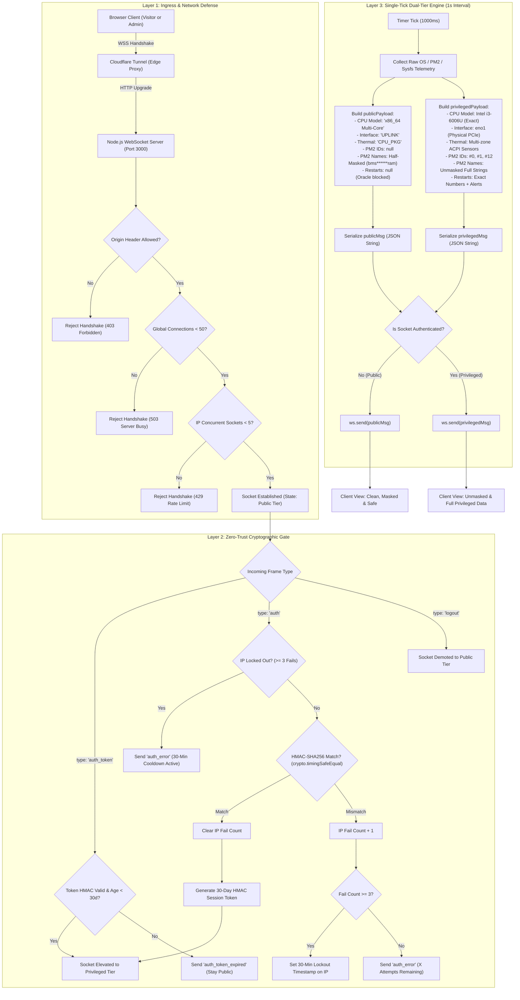
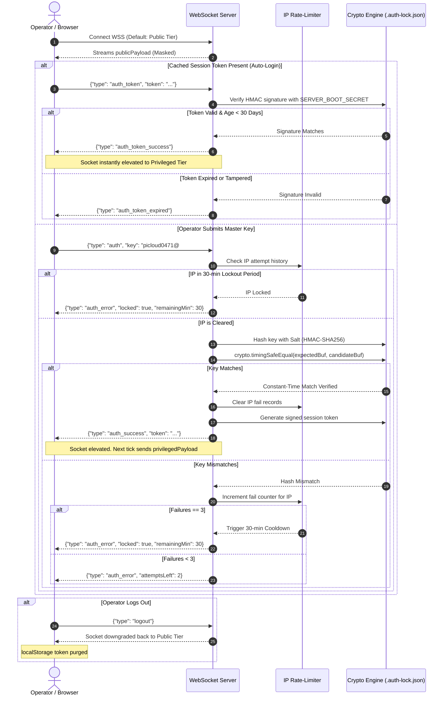

# PiCloud Telemetry & Zero-Trust Security Architecture

This document details the security model, ingress controls, cryptographic gate, and dual-tier telemetry streaming pipeline powering the **PiCloud Server Metrics Dashboard** (`https://info.govindsr.me` / `wss://serverws.govindsr.me`).

---

## 1. System Overview & Dataflow Architecture

The dashboard implements a **Zero-Trust Dual-Tier Architecture**. Public visitors receive a sanitized, privacy-hardened telemetry stream that hides microarchitecture details, hardware network bindings, internal process identifiers, and crash feedback oracles. Privileged operators can unlock full, unmasked telemetry and motherboard-level sensors in real time via an authenticated WebSocket session.

---

## 2. Authentication & Brute-Force Lockout Sequence

---

## 3. Four Core Security Pillars

### Pillar 1: Ingress & Resource Exhaustion (DoS) Defense
1. **Origin Header Validation:** Executed inside Node's native `verifyClient` callback before WebSocket protocol upgrade. Unauthorized origins are rejected immediately with `403 Forbidden`.
2. **Per-IP Concurrency Limit:** Sockets per IP address (resolved via Cloudflare `cf-connecting-ip` / `x-forwarded-for`) are capped at `5` to prevent socket starvation.
3. **Global Concurrency Ceiling:** Capped at `50` simultaneous connections (`503 Service Unavailable`) to prevent host memory and file descriptor exhaustion.
4. **Strict Frame Size Cap:** Incoming WebSocket frames are clamped to `1024 bytes` (`maxPayload: 1024`). Any malformed buffer flooding attempt is dropped before JSON deserialization.

### Pillar 2: Cryptographic Gate & Zero Plaintext Footprint
1. **Salted HMAC-SHA256 Storage:** Plaintext keys are never stored on disk. `.auth-lock.json` stores a cryptographically generated 16-byte random salt and HMAC-SHA256 digest. If a plaintext key is ever provided in the file, it is automatically hashed and wiped from disk on boot.
2. **Timing-Attack Immunity (`crypto.timingSafeEqual`):** Comparisons between client candidate hashes and stored digests are executed in strict constant time, completely preventing microsecond side-channel analysis from deriving characters.
3. **3-Strike Hard Lockout:** Three consecutive failed authentication attempts from any IP enforce a 30-minute hard cooldown. Expired lockout records are automatically purged via background garbage collection.

### Pillar 3: Dual-Tier Telemetry Isolation
- The broadcast engine reads host telemetry **once per second** ($O(1)$ CPU overhead).
- It constructs **two distinct payload trees** (`publicPayload` and `privilegedPayload`) and serializes each once.
- Sensitive telemetry is filtered on the server before transmission; public clients never receive sensitive fields:
  - **CPU Model:** Masked to `x86_64 Multi-Core Processor` (preventing Skylake CVE microarchitecture fingerprinting).
  - **NIC Identifier:** Masked to `[UPLINK]` (hiding onboard PCIe `eno1` bus bindings).
  - **PM2 Service Names:** The middle ~50% of each service name is replaced with asterisks (e.g., `bms******ram`, `Sma*****lth`) to prevent service discovery.
  - **PM2 Instance IDs & Restarts:** Stripped from public payloads to eliminate the real-time crash-confirmation oracle during automated fuzzing or DoS attacks.
  - **Console Logs (stdout/stderr):** Completely gated to privileged sockets.

### Pillar 4: Friction-Free 30-Day Session Persistence
- Upon authentication, the server signs a cryptographically verifiable token (`timestamp.nonce.signature`) using a machine-local boot secret.
- The browser caches this token in `localStorage`.
- When an operator returns or refreshes within 30 days, the token automatically restores privileged access during the initial handshake without prompting for the password again.

---

## 4. Telemetry Masking Matrix

| Telemetry Field | Public Tier (Unauthenticated) | Privileged Tier (Authenticated) | Risk Mitigated |
| :--- | :--- | :--- | :--- |
| **CPU Model** | `x86_64 Multi-Core Processor` | `Intel(R) Core(TM) i3-6006U CPU @ 2.00GHz` | Prevents targeted speculative execution CVE exploits (Spectre, Meltdown, MDS). |
| **Network Interface** | `[UPLINK]` | `[ENO1]` | Conceals hardware PCIe network topology and physical bus indices. |
| **PM2 Process Name** | Middle 50% asterisks (`bms******ram`) | Full Unmasked Name (`bms-telegram`) | Prevents automated service discovery and OSINT mapping. |
| **PM2 Instance ID** | `🔒` (`null`) | Exact PM2 ID (`#12`, `#4`, etc.) | Hides internal orchestration order and worker IDs. |
| **PM2 Restarts** | `🔒` (`null`) | Real restart counts + excessive alerts | Eliminates real-time crash confirmation oracle for fuzzers. |
| **Motherboard Sensors** | Package temp only (`CPU_PKG`) | Full ACPI sensor tree (`x86_pkg_temp`, `acpitz`) | Conceals motherboard hardware revision and thermal bus paths. |
| **Application Logs** | Restricted (`🔒 [LOCKED]`) | Live stdout / stderr stream | Prevents IP, stack trace, and internal credential leakage. |
